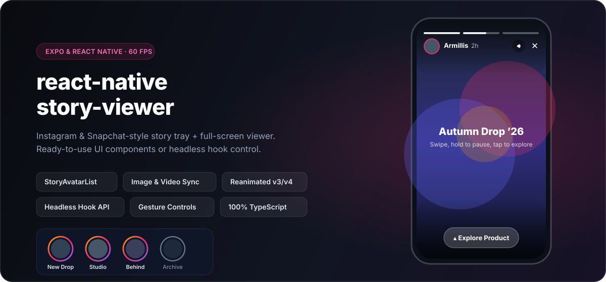

<p align="center">
  
</p>

<h1 align="center">@mertakdag/react-native-story-viewer</h1>

<p align="center">
  Instagram &amp; Snapchat-style story ring tray and full-screen story viewer for <strong>React Native</strong> &amp; <strong>Expo</strong>.<br />
  Drop-in 60fps UI components out of the box, or build a completely custom interface with the headless <code>useStoryViewer</code> hook.
</p>

<p align="center">
  <a href="https://www.npmjs.com/package/@mertakdag/react-native-story-viewer"></a>
  <a href="https://www.npmjs.com/package/@mertakdag/react-native-story-viewer"></a>
  <a href="https://github.com/MertAkdag/react-native-story-viewer/actions/workflows/ci.yml"></a>
  <a href="./LICENSE"></a>
  
  
</p>

---

## ✨ Features

- **Story Tray + Full-Screen Viewer:** Includes both `<StoryAvatarList />` (horizontal seen/unseen story rings) and `<StoryViewer />` (full-screen modal player).
- **Hardware-Accelerated Image & Video:** Powered by `expo-image` and `expo-video`, with automatic video duration detection, poster preview while buffering, and a built-in mute/unmute toggle.
- **60fps Reanimated Gestures:**
  - **Tap left / right** to step backward or forward through stories.
  - **Press & hold** anywhere to pause playback and release to resume smoothly.
  - **Swipe horizontally** to jump between story groups.
  - **Swipe down** with spring physics to dismiss the viewer.
- **Smart Seen & Prefetch Engine:** Automatically resumes each group from its first unseen story (`isSeen !== true`) and prefetches upcoming images/posters in the background for zero-spinner transitions.
- **CTA Pill & Custom Slots:** Built-in glassmorphic Call-to-Action pill (auto-pauses playback on tap) plus render overrides for header, footer, close, mute, and CTA icons.
- **Headless Architecture:** Need a totally custom layout? Use `useStoryViewer` directly and let the hook manage timers, gestures, video sync, and prefetching for you.
- **100% Strict TypeScript:** Shipped with CommonJS, ES Module, and `.d.ts` type definitions.

---

## 📦 Installation

Install the required peer dependencies first (if not already present in your Expo / React Native app):

```bash
npx expo install expo-image expo-video react-native-gesture-handler react-native-reanimated react-native-safe-area-context
```

Then install `@mertakdag/react-native-story-viewer`:

```bash
npm install @mertakdag/react-native-story-viewer
# or
yarn add @mertakdag/react-native-story-viewer
```

> **Note:** Make sure your app root is wrapped with `<SafeAreaProvider>` from `react-native-safe-area-context` and that `react-native-reanimated` is configured according to your Expo / React Native version.

---

## 🚀 Quick Start (Tray + Viewer)

Pair `<StoryAvatarList />` with `<StoryViewer />` for a complete Instagram-style story flow in under 50 lines:

```tsx
import React, { useState, useCallback } from 'react';
import { View, Linking } from 'react-native';
import { SafeAreaProvider } from 'react-native-safe-area-context';
import {
  StoryAvatarList,
  StoryViewer,
  type StoryGroup,
  type StoryItem,
} from '@mertakdag/react-native-story-viewer';

const INITIAL_GROUPS: StoryGroup[] = [
  {
    id: 'armillis',
    name: 'Armillis',
    avatarUrl: 'https://images.unsplash.com/photo-1534528741775-53994a69daeb?w=240&q=80',
    stories: [
      {
        id: 'story-1',
        mediaType: 'image',
        mediaUrl: 'https://images.unsplash.com/photo-1518770660439-4636190af475?w=1080&q=80',
        timestamp: '2h',
        isSeen: false,
        cta: {
          type: 'link',
          value: 'https://armillis.com',
          label: 'Explore Product',
        },
      },
      {
        id: 'story-2',
        mediaType: 'video',
        mediaUrl: 'https://commondatastorage.googleapis.com/gtv-videos-bucket/sample/ForBiggerJoyrides.mp4',
        posterUrl: 'https://images.unsplash.com/photo-1492144534655-ae79c964c9d7?w=1080&q=80',
        timestamp: '1h',
        isSeen: false,
      },
    ],
  },
];

export default function App() {
  const [groups, setGroups] = useState<StoryGroup[]>(INITIAL_GROUPS);
  const [activeGroupIndex, setActiveGroupIndex] = useState(0);
  const [isVisible, setIsVisible] = useState(false);

  const handleStorySeen = useCallback((story: StoryItem, group: StoryGroup) => {
    setGroups((prev) =>
      prev.map((g) =>
        g.id !== group.id
          ? g
          : {
              ...g,
              stories: g.stories.map((s) =>
                s.id === story.id ? { ...s, isSeen: true } : s,
              ),
            },
      ),
    );
  }, []);

  return (
    <SafeAreaProvider>
      <View style={{ flex: 1, paddingTop: 64 }}>
        <StoryAvatarList
          groups={groups}
          sortUnseenFirst
          onGroupPress={(_, originalIndex) => {
            setActiveGroupIndex(originalIndex);
            setIsVisible(true);
          }}
        />

        <StoryViewer
          groups={groups}
          initialGroupIndex={activeGroupIndex}
          isVisible={isVisible}
          onClose={() => setIsVisible(false)}
          onStorySeen={handleStorySeen}
          onCtaPress={(cta) => {
            if (cta.type === 'link') {
              Linking.openURL(cta.value);
            }
          }}
        />
      </View>
    </SafeAreaProvider>
  );
}
```

---

## 🎨 Customization & Theming

Customize ring colors, progress bar colors, playback behavior, or override individual UI slots without rebuilding the viewer from scratch:

```tsx
<StoryViewer
  groups={groups}
  initialGroupIndex={activeGroupIndex}
  isVisible={isVisible}
  onClose={() => setIsVisible(false)}
  theme={{
    unseenRingColor: '#F59E0B',
    seenRingColor: '#6B7280',
    backgroundColor: '#090B10',
    progressActiveColor: '#FFFFFF',
    progressInactiveColor: 'rgba(255, 255, 255, 0.28)',
  }}
  config={{
    defaultDurationMs: 6000,
    defaultMuted: true,
    showMuteButton: true,
    startFromFirstUnseen: true,
    prefetchNextMedia: true,
    pauseOnCtaPress: true,
    dismissThreshold: 140,
    swipeHorizontalThreshold: 60,
  }}
  customComponents={{
    renderFooter: (story, group) => (
      <MyReplyBar storyId={story.id} author={group.name} />
    ),
  }}
/>
```

---

## 🧠 Headless Usage (`useStoryViewer`)

When you need full layout freedom, use `useStoryViewer` directly (and optionally mix in composable building blocks like `StoryMedia` and `StoryProgressBar`):

```tsx
import React from 'react';
import { Modal, Pressable, StyleSheet, Text, View } from 'react-native';
import {
  useStoryViewer,
  StoryMedia,
  StoryProgressBar,
  type StoryGroup,
} from '@mertakdag/react-native-story-viewer';

export function CustomStoryModal({
  groups,
  isVisible,
  onClose,
}: {
  groups: StoryGroup[];
  isVisible: boolean;
  onClose: () => void;
}) {
  const viewer = useStoryViewer({
    groups,
    isVisible,
    callbacks: {
      onClose,
      onStorySeen: (story, group) => {
        console.log('Seen:', group.id, story.id);
      },
    },
  });

  if (!isVisible || !viewer.currentGroup || !viewer.currentStory) {
    return null;
  }

  return (
    <Modal visible={isVisible} transparent onRequestClose={onClose}>
      <View style={styles.container}>
        <StoryMedia
          mediaUrl={viewer.currentStory.mediaUrl}
          mediaType={viewer.currentStory.mediaType}
          posterUrl={viewer.currentStory.posterUrl}
          isPaused={viewer.isPaused}
          isMuted={viewer.isMuted}
          onMediaReady={viewer.notifyMediaReady}
          onVideoEnd={viewer.notifyVideoEnd}
        />

        <View style={styles.topBar}>
          <StoryProgressBar
            totalCount={viewer.currentGroup.stories.length}
            currentIndex={viewer.currentStoryIndex}
            progress={viewer.progress}
          />
          <Text style={styles.author}>{viewer.currentGroup.name}</Text>
        </View>

        <View style={styles.touchRow}>
          <Pressable
            style={styles.half}
            onPress={viewer.handlePrev}
            onLongPress={viewer.pauseProgress}
            onPressOut={viewer.resumeProgress}
          />
          <Pressable
            style={styles.half}
            onPress={viewer.handleNext}
            onLongPress={viewer.pauseProgress}
            onPressOut={viewer.resumeProgress}
          />
        </View>
      </View>
    </Modal>
  );
}

const styles = StyleSheet.create({
  container: { flex: 1, backgroundColor: '#000' },
  topBar: { position: 'absolute', top: 56, left: 16, right: 16, zIndex: 10 },
  author: { color: '#FFF', fontSize: 16, fontWeight: '700' },
  touchRow: { ...StyleSheet.absoluteFillObject, flexDirection: 'row' },
  half: { flex: 1 },
});
```

---

## 📚 API Reference

### `<StoryViewer />` Props (`StoryViewerProps`)

| Prop | Type | Default | Description |
| --- | --- | --- | --- |
| `groups` | `StoryGroup[]` | **Required** | Story groups to display. |
| `isVisible` | `boolean` | **Required** | Controls whether the full-screen modal is open. |
| `onClose` | `() => void` | **Required** | Fired on close button press, downward swipe, Android back press, or after final story finishes. |
| `initialGroupIndex` | `number` | `0` | Index of the story group to open first. |
| `initialStoryIndex` | `number` | `undefined` | Explicit story index within the initial group (overrides `startFromFirstUnseen`). |
| `config` | `StoryViewerConfig` | `{}` | Playback, gesture, mute, and prefetch options. |
| `theme` | `StoryViewerTheme` | `{}` | Ring, backdrop, and progress bar colors. |
| `customComponents` | `StoryViewerComponents` | `{}` | Custom render functions for header, footer, close, mute, or CTA icon. |
| `onStorySeen` | `(story, group) => void` | `undefined` | Fired as soon as a story becomes active. |
| `onStoryChange` | `(story, group, storyIndex) => void` | `undefined` | Fired whenever the active story index changes. |
| `onGroupChange` | `(group, groupIndex) => void` | `undefined` | Fired when transitioning to another story group. |
| `onCtaPress` | `(cta, story, group) => void` | `undefined` | Fired when the bottom CTA pill is pressed. |
| `onComplete` | `() => void` | `undefined` | Fired right before closing when the very last story finishes. |

### `<StoryAvatarList />` Props (`StoryAvatarListProps`)

| Prop | Type | Default | Description |
| --- | --- | --- | --- |
| `groups` | `StoryGroup[]` | **Required** | Story groups rendered in the horizontal tray. |
| `onGroupPress` | `(group, originalIndex) => void` | **Required** | Fired when an avatar ring is pressed. Always passes the group's original index in `groups`. |
| `avatarSize` | `number` | `68` | Diameter of each circular avatar image in pixels. |
| `ringWidth` | `number` | `2.5` | Stroke thickness of the status ring in pixels. |
| `gap` | `number` | `14` | Horizontal spacing between items in pixels. |
| `showNames` | `boolean` | `true` | Show single-line group names below avatars. |
| `nameColor` | `string` | `'#111827'` | Text color for unseen group names. |
| `seenNameColor` | `string` | `'#6B7280'` | Text color for seen group names. |
| `sortUnseenFirst` | `boolean` | `false` | Visually sort unseen groups before seen groups while preserving `originalIndex`. |
| `theme` | `Pick<StoryViewerTheme, 'seenRingColor' \| 'unseenRingColor'>` | `{}` | Customize seen and unseen ring colors. |
| `renderAvatarItem` | `({ group, index, isSeen, onPress }) => ReactNode` | `undefined` | Custom renderer for complete visual control over each tray item. |

### `StoryViewerConfig`

| Option | Type | Default | Description |
| --- | --- | --- | --- |
| `defaultDurationMs` | `number` | `5000` | Display duration (ms) for images or videos without a known duration. |
| `dismissThreshold` | `number` | `150` | Downward swipe distance (px) required to close the modal. |
| `swipeHorizontalThreshold` | `number` | `60` | Horizontal swipe distance (px) required to switch groups. |
| `defaultMuted` | `boolean` | `false` | Start video stories muted when the viewer opens. |
| `showMuteButton` | `boolean` | `true` | Display a mute/unmute button in the header during video stories. |
| `startFromFirstUnseen` | `boolean` | `true` | Automatically open each group at its first story with `isSeen !== true`. |
| `prefetchNextMedia` | `boolean` | `true` | Prefetch upcoming story images and video posters in the background. |
| `pauseOnCtaPress` | `boolean` | `true` | Pause story progress automatically when the user taps the CTA button. |

### Data Models (`StoryGroup` & `StoryItem`)

```ts
type StoryGroup = {
  id: string;
  name: string;
  avatarUrl: string;
  isSeen?: boolean;
  stories: StoryItem[];
  [key: string]: any; // Custom metadata supported
};

type StoryItem = {
  id: string;
  mediaUrl: string;
  mediaType: 'image' | 'video';
  posterUrl?: string | null;    // Shown while video buffers
  thumbnailUrl?: string;
  durationMs?: number;          // Auto-detected for videos if omitted
  timestamp?: string;           // e.g. "2h", "Just now"
  isSeen?: boolean;
  cta?: {
    type: string;
    value: string;
    label: string;
  } | null;
  [key: string]: any; // Custom metadata supported
};
```

---

## 📱 Running the Example App

A complete Expo demo app showcasing `<StoryAvatarList />`, image & video stories, CTAs, and seen-state transitions lives in [`./example`](./example):

```bash
git clone https://github.com/MertAkdag/react-native-story-viewer.git
cd react-native-story-viewer
npm install --legacy-peer-deps
npm run build

cd example
npm install
npx expo start
```

---

## 📄 License

MIT © [Mert Akdağ](https://mertakdag.com)
